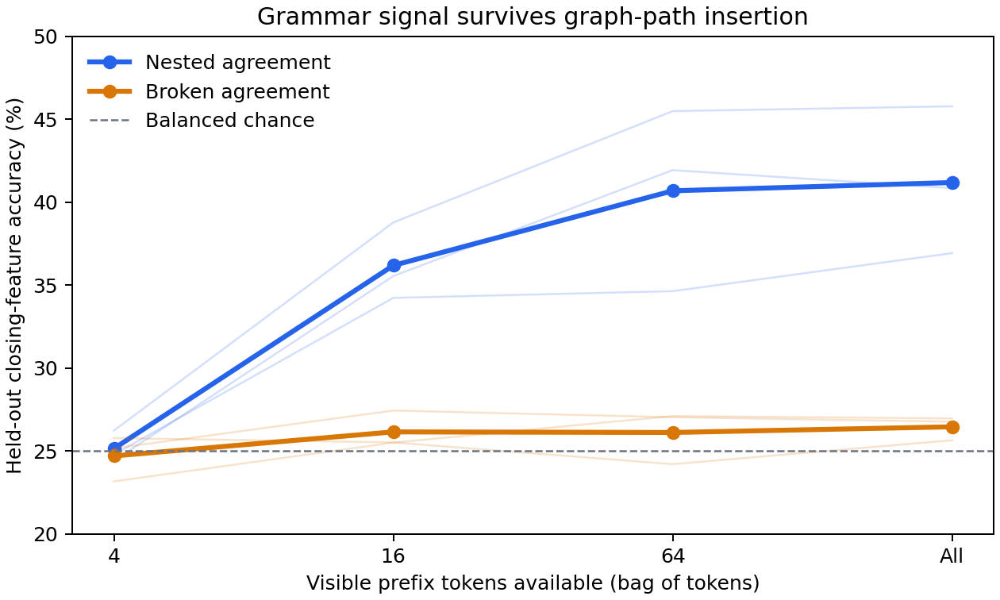

# Grammar pilot results

Three grammar/prior seeds, each with an agreeing and broken-agreement corpus: **9,000 documents total**, on the same 200-node graph. Each of six corpora has 1,000 training, 250 validation, and 250 test documents.

## Held-out earlier-prefix signal

The probe predicts one of four closing features, stopping **before the final bridge begins**. Means below weight the three seeds equally.

| Prefix window | Nested agreement | Broken agreement |
|---|---:|---:|
| 4 | 25.2% | 24.7% |
| 16 | 36.2% | 26.2% |
| 64 | 40.7% | 26.1% |
| full | 41.2% | 26.5% |

Longer prefixes reveal agreement information in all three grammar seeds, while controls remain near chance. Logistic regression uses token counts and discards order: this establishes accessible earlier-prefix information, **not learned hierarchical parsing**. Parse sidecars identify query positions and targets but are excluded from input features. Regularization is selected on validation documents.

Immediate-before-closer probes are also saved in `report.json`. They perform above chance even on controls because the final graph bridge reveals local information; they should not be interpreted as evidence of grammar.

## Generator checks

| Seed | Agreement | Control agreement | Mean visible agreement gap | Gap p90 | Maximum observed depth |
|---|---:|---:|---:|---:|---:|
| 0 | 100.0% | 25.4% | 31.2 | 63 | 3 |
| 1 | 100.0% | 26.3% | 26.5 | 53 | 3 |
| 2 | 100.0% | 25.2% | 30.5 | 61 | 3 |

Rule usage, realized token/core frequencies, raw consecutive-core MI, exact 1–5-grams, bridge distances, conditional bridge entropy and rejection counts are in `report.json`. Structural summaries cover all splits; frequencies, MI and n-grams cover training only. Bridge entropy is conditional on latent endpoints, not marginal visible-sequence entropy. Raw MI has finite-sample bias.

## Validation and reproduction

65 related unit tests passed; Ruff and whitespace checks passed. A two-step GPU integration run with the 512-wide/eight-block AR model completed at `/tmp/hubpaths_grammar_preflight` (validation NLL 5.30821). That checks the data interface, not convergence; W&B was disabled. The pilot vocabulary produces about 25.4M model parameters.

Commands, rules, controls and limitations: [GRAMMAR.md](../../../tasks/hubpaths/GRAMMAR.md). Training config: `configs/experiment/hubpaths_grammar_ar.yaml`. Corpora: `data_cache/hubpaths/grammar_pilot/`.

No confidence intervals are claimed: multiple queries per document are dependent, and three grammar seeds on one graph are a small pilot.
