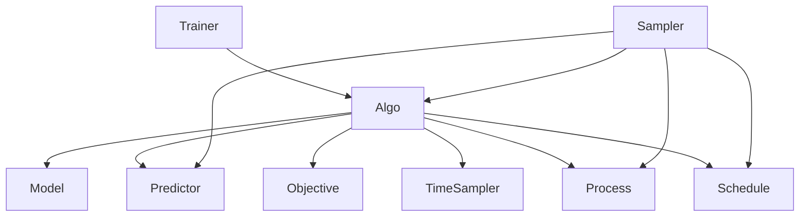

# Core architecture

`core/` is a self-contained implementation of the training and generation
system. Its components own their mathematical or operational logic, and Algo
coordinates training and prediction. Samplers orchestrate generation. The
implemented families include discrete diffusion, Gaussian diffusion over discrete
representations, spherical flow matching, autoregressive generation, and hybrid
combinations of discrete and continuous processes, including CANDI.

This document records the agreed design and component data flow; see `README.md` for
entrypoints, root `configs/` for Hydra configuration, and `VALIDATION.md` for
verification. Formal typing is deferred; constructor checks currently enforce
component compatibility.

## Self containment

Library implementations live inside `core/`: models and supporting layers,
mathematical components, utilities, checkpoint handling, EMA,
training, evaluation, and sweep support. The root `main.py` and `frontier.py`
provide command-line entrypoints and delegate to the library. Hydra configs
live in root `configs/`.

Code in `core/` must not import legacy repository modules or load configuration
files from legacy directories, directly or indirectly. Copying the existing DiT
and its dependencies into `core/` is appropriate; those copies can then be
adapted to the new boundaries. Installed third-party libraries remain external
dependencies. Datasets and checkpoints can be supplied through explicit paths.

The old implementation remains available in Git history. The current checkout
runs with `core/`, root `configs/` and entrypoints, the uv dependency files, and
explicitly supplied data or artifacts. No removed repository modules are required.

## Training and sampling orchestration

Algo orchestrates training and exposes model-to-posterior prediction methods.
The sampler orchestrates generation, accessing the process, noise schedule,
and predictor through Algo. Mathematical components do not hold references to
one another: the process consumes keep rates and probabilities, the objective
consumes predictions and targets, and the predictor consumes network outputs.



During generation, Algo runs the network and applies the requested posterior
parameterization. The sampler obtains these predictions, computes schedule
values, invokes process operations, and owns all step and final-denoising
policies. Algo contains no ancestral steps, reverse-transition orchestration,
or entropy-bounded commitment logic.

## Component responsibilities

### Model

The model owns the neural architecture and its learned parameters: DiT layers,
embeddings, time-conditioning layers, and output heads. It accepts prepared
network inputs and returns raw outputs.

For MDLM, these are noisy token IDs and a conditioning value supplied by Algo,
with raw vocabulary logits returned. The model does not apply posterior
constraints, temperature, top-k, or top-p. Algo decides whether time conditioning
is active and supplies the appropriate conditioning value.

Architecture-specific cache operations belong to the model. Trajectory cache
lifetime and reuse decisions belong to sampling orchestration, when introduced.

For permuted autoregression, the model receives separate query and key position
IDs. These describe positions in the output sequence; causal visibility and KV
cache append order follow the generation order. Generation-order policies own
permutation construction, while Algo arranges training inputs, targets, and loss
masks. The sampler owns incremental generation and restoring output positions.
This is an autoregressive method, independent of MDLM, and needs no corruption
process or noise schedule.

### Prediction parameterization

The predictor defines how raw neural-network output is mathematically
interpreted. The initial object is a posterior parameterization that produces
the predicted distribution over clean tokens.

For MDLM, required parameterization consists of excluding the absorbing mask
from clean-token support, normalizing the distribution, and making predictions
at already-visible positions point masses at their observed token. Algo must
therefore supply the observed tokens and mask identity as well as raw logits.
These constraints apply during both training and generation.

The predictor also owns all optional logit shaping: temperature, top-k, top-p,
and greedy projection. Shaping settings are attributes of the posterior alone. Algo selects an
explicit training, sampling, or greedy prediction method. The training method
never applies optional shaping. It must not be selected implicitly by
`model.training`: validation loss also requires unshaped predictions.

Shaping must preserve the mandatory posterior constraints. In particular, it
must never restore probability to the absorbing mask or alter a visible token.
The shaping path applies temperature, top-k, then top-p through independent
tensor helpers, and returns constrained log probabilities. Greedy denoising
adds a point-mass projection. EB computes entropy before applying its configured
commitment projection. The EB sampler keeps the posterior prediction locally and supplies that same
prediction to entropy and commitment methods on the predictor. No opaque handle
or shared prediction cache is needed.

The new training path deliberately removes the existing MDLM behavior in which
temperature is applied through the shared forward path. Training and validation
objectives always consume unshaped predictions; inference may request shaping.

Future parameterizations may represent means, scores, noise, or velocities. Algo
selects any conversion needed for a consumer and supplies the necessary values.
Reusable conversion mathematics should live with the component that owns its
meaning rather than accumulate in Algo. Their exact placement will be settled
when implementing the relevant continuous method.

### Process

The process owns the state space and the mathematical execution of forward
corruption, prior sampling, and supported reverse transitions. It receives all
required parameters from Algo and does not evaluate the network, shape logits,
sample training times, or call the noise schedule.

The absorbing process uses token IDs plus an absorbing mask state. Its forward
operation receives clean tokens, keep rates, and any mask identifying positions
eligible for corruption. Its reverse operation receives the current state, a
clean-token posterior, source and destination keep rates, and any conditioning
constraints. It executes the random draws and returns the next state.

Algo resolves vocabulary and mask identity consistently for model, predictor,
and process construction. The process does not inspect a tokenizer to infer
these settings.

For continuous methods, a process may expose reverse moments, a vector
field, or a conditional flow operation. Numerical integration belongs to the
sampler. Do not force every process into a single discrete-transition interface
before implementing a continuous example.

Spherical flow matching uses a spherical process rather than an affine Gaussian
path. The representation owns unit-normalized token embeddings; the process owns
spherical corruption and log/exp maps. The sampler converts the token posterior
into tangent velocity and advances the state. Averaging tangent vectors toward
individual token embeddings is distinct from taking a Gaussian posterior-mean
embedding and using that as a spherical target.

### Noise schedule

The noise schedule converts time into the process parameters that describe the
noise level. For MDLM it returns a keep rate and its derivative with respect to
the supplied time coordinate. It neither samples time nor modifies tokens.

The initial schedule is simple, but the boundary should permit future schedules
with learned parameters, buffered statistics, or multiple output coefficients.
Those features need not be implemented for the first MDLM slice.

### Time sampler

The time sampler chooses training times. The initial module owns uniform and
antithetic sampling, including the behavior needed to partition globally
stratified draws across devices and gradient accumulation steps.

Algo supplies batch and partition context explicitly; the time sampler does not
reach into Lightning. Randomness and partition behavior must be explicit enough
to test and reproduce. Inference step selection belongs to the sampler rather
than this training-time component.

If nonuniform sampling is added later, the time sampler must expose the sampling
probabilities or correction information needed to preserve the intended
objective. Algo routes that information to the objective.

### Objective

The objective owns the mathematical training loss. MDLM uses weighted
cross-entropy on clean-token targets. Algo supplies unshaped posterior log
probabilities, target token IDs, and schedule values needed to compute the
weight. The objective returns per-token losses.

The objective needs the clean target, but not the raw batch, the model's noisy
input, a model reference, or a process reference. Algo handles batch preparation
and applies the loss mask and reduction before returning results to the trainer.
The loss mask and corruption mask have distinct meanings even if a particular
task initially uses the same values for both.

Future objectives may have additional terms or require multiple evaluations.
Algo coordinates those evaluations while the objective owns their mathematical
weighting and gradient semantics. The first implementation need not generalize
all such training recipes.

### Sampler

The sampler orchestrates generation: initialization, time grid, schedule
queries, prediction requests, reverse steps, final denoising, stopping, and
trajectory bookkeeping. It uses Algo's process, schedule, and predictor and
requests parameterized predictions through Algo. It never interprets raw logits
or owns shaping settings.

The absorbing process executes each random reverse transition. The sampler
supplies the state, posterior probabilities, and keep rates. EB asks the
predictor for entropy, selects positions, asks the predictor for the configured
commitment distribution, and calls the process to commit those positions.

### Algo

Algo orchestrates training: it prepares inputs, samples training times, evaluates
the schedule, corrupts data, invokes the model and predictor, and calls the
objective. It exposes training, sampling, and greedy prediction methods that
connect the network to the posterior parameterization.

For generation, Algo manages model evaluation mode and delegates the complete
sampling procedure to the sampler. It does not implement reverse steps,
final-denoising steps, acceptance decisions, or commitment execution.

### Trainer and entrypoints

The trainer is the framework integration layer around Algo. It owns optimizer
execution, EMA lifecycle, checkpoint persistence, logging, and integration with
training and evaluation loops. Components own their parameters and buffers;
the trainer must include the applicable component state when optimizing,
checkpointing, restoring, or applying EMA.

Training, standalone sampling, and evaluation use the root `main.py`; pretrained
frontier sweeps use `frontier.py`. Both use recursive Hydra construction and
delegate execution to `core/`. Maintained config groups live in
`configs/`. An algorithm config group declares its `_target_` and
references the selected component configs. The training wrapper calls
`instantiate(config.algorithm)`; the evaluator instantiates the sampler config
directly. Adding a component or algorithm requires its implementation and YAML
config. Individual components receive their own settings rather than an
unrestricted global configuration. A sweep launches training configurations
instead of maintaining another training implementation.

### Task and evaluation

Task defines the learning problem independently of model, process, and sampler.
It owns tokenization, data preparation, training and validation sources, named
evaluation sources, training collation, conditioning layout, and metric
accumulation. It declares a primary metric with a name, min/max direction, and
evaluation source. Its vocabulary describes data tokens; the absorbing process
adds the mask state separately.

The entrypoint instantiates Task once and shares it with the generic Lightning
data module and generation callback. The standalone evaluator receives the same
Task. Selecting `task=sudoku` also selects its default data source, without
requiring separate Sudoku data-module, evaluator, or callback choices.

The initial interface is intentionally small:

- `prepare_data()`, `training_dataset()`, and `validation_dataset()` provide data.
- `evaluation_dataset(name)` supports evaluation sources distinct from training.
- `collate_training(examples)` returns tokens and explicit loss/corruption masks.
- `prepare_generation(examples)` returns sanitized prompt tokens and a fixed mask.
- `create_metric_accumulator(name)` returns a fresh accumulator with
  `update(samples, examples, indices)` and `compute()` methods. `compute()` returns
  a task-specific aggregate dataclass with typed record dataclasses. Sudoku uses
  `SudokuAggregate` and `SudokuRecord`, with explicit named metric fields. The
  reporting boundary serializes these using `dataclasses.asdict`.

Sudoku translates the old cache's `attention_mask` into `loss_mask` and
`corruption_mask`. Prompt and padding masks remain distinct; blanks in a Sudoku
puzzle are data, not padding. Ground-truth solution tokens are never present in
generation requests. Metric accumulators retain task-specific references and
aggregate examples without averaging unweighted batch means.

The shared data module owns workers, distributed batch sizes, and DataLoaders.
The evaluator owns generation execution, precision, EMA context, NFE, and timing.
The callback owns evaluation cadence, reproducible subsets, RNG preservation,
and logging. Task never calls a model or sampler. Task's primary metric is
reported and logged; the existing best-checkpoint policy still uses validation
NLL. Training objectives and sampling policies remain separate concerns.

Sudoku, Text8, OpenWebText, and TinyGSM are implemented. Maze and Zebra follow;
HubPaths is explicitly out of scope. Task quality evaluation uses generated
outputs and does not require likelihoods from the generating method.

Text8 pairs unconditional generations with fixed held-out windows and uses a
training-only vocabulary for both. Shared text metric utilities return typed
word counts: occurrences, valid occurrences, distinct words, and distinct valid
words, with inclusive minimum-length filters. Aggregation sums occurrences but
unions word sets for corpus uniqueness; per-sample means remain separate. The
shared callback flattens nested aggregate metrics for logging. Source hashes,
reference split, vocabulary size, and matched generated/reference records are
saved for reproducibility. Empty denominators produce null ratios, not NaN.

The token-space config handles both appended masks (Sudoku) and pre-existing
reserved masks (Text8 ID 4 with 35 model outputs). This choice is explicit and
does not change the Task's data vocabulary or introduce task branches in Algo.

OpenWebText uses a reusable causal reference scorer for generated-text
perplexity and empirical sample entropy. The generator is never asked for a
likelihood. Typed per-sample loss sums and token counts permit corpus-weighted
aggregation without changing the original EOS/context mathematics.

TinyGSM uses one source for training and GSM8K for generation evaluation.
`evaluation_batches(dataset, indices, batch_size)` lets a task group prompts
without taking over the sampling loop. The default yields contiguous batches;
TinyGSM groups equal-length prompts. Record order and NFE follow the yielded
batches. `prepare_evaluation(name)` is separate from training preparation, so
standalone sampling never requires an unrelated training corpus.

Generated-code isolation lives in `core/tasks/sandbox.py`. Its API accepts code,
an entrypoint, and a timeout; task-specific code extraction, numeric parsing,
and correctness scoring remain outside it. Execution has no non-isolated
fallback. Task records expose execution failures separately from model errors.

## MDLM mathematics

Use `x0` for clean tokens and `xt` for the current noisy tokens. Time increases
from clean toward noisy; reverse generation moves from `t` to `s` with `s < t`.
The keep rate `alpha(t)` decreases as time increases.

For the initial log-linear schedule with endpoint parameter `epsilon`:

```text
alpha(t) = 1 - (1 - epsilon) * t
dalpha_dt(t) = -(1 - epsilon)
```

At each eligible position, forward corruption preserves `x0` with probability
`alpha_t` and replaces it with the absorbing mask otherwise. Protected positions
remain unchanged. The generation prior is an all-mask state, with prompt tokens
inserted under explicit conditioning constraints.

For a reverse step at a masked position:

```text
reveal_probability = (alpha_s - alpha_t) / (1 - alpha_t)
```

The process reveals with this probability and draws the revealed token from the
supplied clean posterior; otherwise it keeps the mask. Visible positions remain
unchanged. A final clean transition uses `alpha_s = 1`. These formulas require
valid ordered keep rates and a noisy source; the already-clean endpoint needs
explicit handling rather than division by zero.

The MDLM per-token objective is:

```text
cross_entropy = -log_posterior[target_token]
weight = -dalpha_dt / (1 - alpha_t)
loss = weight * cross_entropy
```

Visible positions contribute zero because their posterior is a point mass at
the observed clean token. Training time bounds must avoid an undefined weight
at the exactly clean endpoint. The schedule endpoint parameter, training time
lower bound, and sampling endpoint settings are separate quantities.

With a nonzero schedule endpoint keep rate, the all-mask generation prior is a
limiting-prior approximation rather than the exact terminal forward marginal.
Preserve and document the selected endpoint behavior instead of silently
changing it during extraction.

## MDLM training interaction

1. The trainer supplies a batch and training context to Algo.
2. Algo extracts targets, corruption constraints, and loss masks.
3. Algo requests training times from the time sampler.
4. Algo evaluates the noise schedule at those times.
5. Algo passes targets and keep rates to the process for corruption.
6. Algo prepares conditioning and passes the noisy tokens to the model.
7. Algo passes raw logits and observed tokens to the posterior parameterization
   through the training-posterior method.
8. Algo passes posterior log probabilities, clean targets, and schedule values
   to the objective.
9. Algo applies the loss mask and reduction and returns loss and reporting values.
10. The trainer performs backward and optimizer execution and manages lifecycle
    operations such as EMA and logging.

Validation uses the same unshaped prediction path without training updates.

## MDLM generation interaction

1. Algo enters evaluation mode and calls the sampler with itself and the prompt.
2. The sampler validates the prompt and asks the process to create the prior.
3. The sampler chooses times and evaluates Algo's noise schedule.
4. The sampler requests a sampling or greedy prediction from Algo.
5. Algo evaluates the network and invokes the corresponding posterior method.
6. The sampler supplies the resulting probabilities and schedule values to
   the process, which executes the reverse transition.
7. For EB, the sampler instead measures entropy through the predictor, selects
   positions, obtains the commitment distribution, and invokes process commitment.
8. The sampler handles termination and final denoising and returns the samples
   and trajectory metadata. Algo restores the model's previous mode.

## Incremental implementation

Build a complete MDLM path before generalizing the interfaces. Port the model
and required infrastructure into `core/` as needed. The first runnable milestone
is a tiny MDLM that can train, save, reload, and generate with ordinary ancestral
sampling entirely through the new package.

Compare component outputs against the old implementation using the same model
weights and controlled inputs. Check schedule values, time sampling and
partitioning, forward corruption, posterior constraints, losses, gradients,
reverse probabilities, and conditioning preservation. Establish baseline
agreement at temperature 1, then verify separately that changing inference
shaping cannot change training or validation loss.

Use exact sample comparisons where random draws and execution order are
controlled. Otherwise check the mathematical distributions rather than requiring
identical stochastic trajectories. Also verify checkpoint reload, EMA behavior,
and training resume when those features are ported.

Complete standalone evaluation and sweep support using the same construction
path. Add other MDLM samplers once the basic slice is stable. Verify independence
by running the new entrypoints with legacy code and configs unavailable, without
deleting the reference implementation to perform that check.

Next, exercise the design with a pure continuous method before adding broader
typing and compatibility machinery. CANDI's eventual role is to combine discrete
and continuous processes through orchestration. Its design and migration remain
out of scope until those individual abstractions are established.

## Decisions deferred to implementation

Exact module names, method signatures, prediction containers, random-generator
plumbing, and the detailed configuration schema remain open. Formal contracts
and typing come later; the meanings and ownership recorded here should guide
the extraction now. Local checks for valid probabilities, endpoints, shapes,
and shaping settings still belong at the relevant operation boundaries.

Importing old model weights for comparison and migrating a complete legacy
training checkpoint are separate tasks. The required degree of legacy
checkpoint compatibility will be decided when checkpoint support is ported.
New checkpoints must preserve the state needed by the new implementation.

## Gaussian diffusion and representation geometry

`GaussianDiffusion` orchestrates encoding, forward corruption, model prediction,
posterior interpretation, and token CE. A representation owns the token-to-state
mapping, posterior-to-clean-mean conversion, and state-to-token decoding.
`OneHotRepresentation` returns one-hot states and converts probabilities to means
by identity. `EmbeddingRepresentation` owns one codebook for lookup, `p @ E`
means, and dot-product decoding. Normalization and trainability are explicit.
The codebook is registered once under the algo, so checkpoints, optimizers, EMA,
and device movement handle it consistently.

The Gaussian process consumes continuous tensors, without representation-specific
branches. The model accepts the configured state dimension; its internal learned
projection and classifier are separate from the representation codebook. The
posterior still describes clean discrete tokens. The algo routes probabilities
through the representation before providing a continuous mean to sampling.

Schedules return `GaussianPath(alpha, sigma, dalpha_dt, dsigma_dt)` for
`x(t)=alpha(t)*encode(x0)+sigma(t)*epsilon`. `OneHotRankSchedule` requires one-hot
geometry and a matching vocabulary. `EmbeddingSphereRankSchedule` requires unit
embeddings and a matching continuous dimension, using an iid uniform-sphere
approximation. `LinearInterpolationSchedule` has no geometry restriction. The
algo validates declared `RepresentationRequirements` against `RepresentationSpec`
and model dimensions during construction. The schedule does not reference the
representation instance or inspect its learned weights.

The continuous sampler family shares a posterior-type check, a sampler-owned
posterior-to-velocity adapter, prompt conditioning, final decoding, and NFE
accounting. Euler, Heun, and adaptive Dormand–Prince differ only in numerical
integration. Reverse-field mathematics stays in the process. Directly predicted
velocities are deferred. Adaptive integration has explicit NFE and step budgets.

Final decoding is explicit: posterior argmax preserves the original one-hot
behavior; representation decoding maps the final predicted clean mean back to
tokens. Both call the model once at the final time. Neither solver contains
one-hot/embedding branches. Learned tokenwise encoders/decoders can implement the
same boundary, but contextual/sequence-compressing encoders require further
mean and conditioning semantics before they are supported.

## Adaptive schedule feedback

Adaptive schedules own observation buffers, fitting, time remapping, and persisted
state. The algorithm selects the configured observation signal and supplies
masked, detached per-example losses during training. The schedule never calls the
model or objective. Normalized posterior and plug-in predictions support token
cross-entropy feedback; score parameterizations require objective feedback.
Validation and sampling do not update adaptation state.

S-FLM and CDCD use separate fitters under `noise_schedules/adaptive`, with shared
buffering and checkpoint restoration. Keep-rate wrappers preserve the discrete
schedule interface. Gaussian wrappers compose a fixed base path with an adaptive
clock and apply the chain rule to both path derivatives, preserving representation
requirements. Samplers use the same schedule interface without adaptive-specific
branches. The original S-FLM time-coordinate fit is the default; physical-coordinate
fitting is explicit. See `noise_schedules/adaptive/README.md` for reference parity
and the boundary stabilization needed by the core process contracts.

## Optional self-conditioning

Models own an optional conditioning adapter and can return logits together
with their final hidden state. The shared prediction coordinator owns detached
training bootstraps and feedback selection. Algorithms supply ordinary model
inputs, predictor endpoints, and the representation's expected-embedding
conversion explicitly. MDLM contains no self-conditioning branches.

Expected-embedding feedback requires token probabilities and uses the unshaped
prediction, including its mathematical constraints. Hidden-state feedback does
not require probabilities and passes through an affine LayerNorm before direct
addition in both training and sampling. Its scale and bias start at zero, and
it has no dense projection. Expected-embedding projections also start at zero. Raw residual-stream magnitude is unconstrained;
repeated feedback must not amplify that magnitude across sampling steps.
Expected embeddings retain their representation's geometry without this
normalization. The configuration is validated during construction;
arbitrary score outputs must not be silently treated as token probabilities.
No component reaches into another component to discover a representation.

Samplers own a local prediction session. The session stores detached feedback
only for that trajectory and forwards prediction requests through the algorithm.
Fixed-step continuous solvers freeze feedback across their stages, committing it
after a successful step. Adaptive ODE feedback is explicitly unsupported until
rejected stages and derivative caches can be handled consistently. MDLM,
Gaussian fixed-step sampling, and spherical sampling share this machinery;
additional algorithm adapters can reuse it without changing their objectives.

The generic training policy samples bootstrap examples independently; evaluation
has a separate bootstrap probability. Bootstrap passes neither evaluate the
objective nor update adaptive schedule observations. Embedding and schedule
gradient rules specific to RePlaid are separate from this architectural feature.
