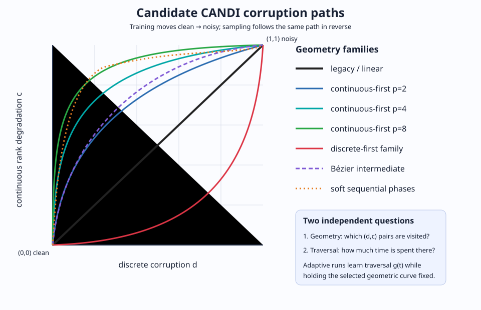
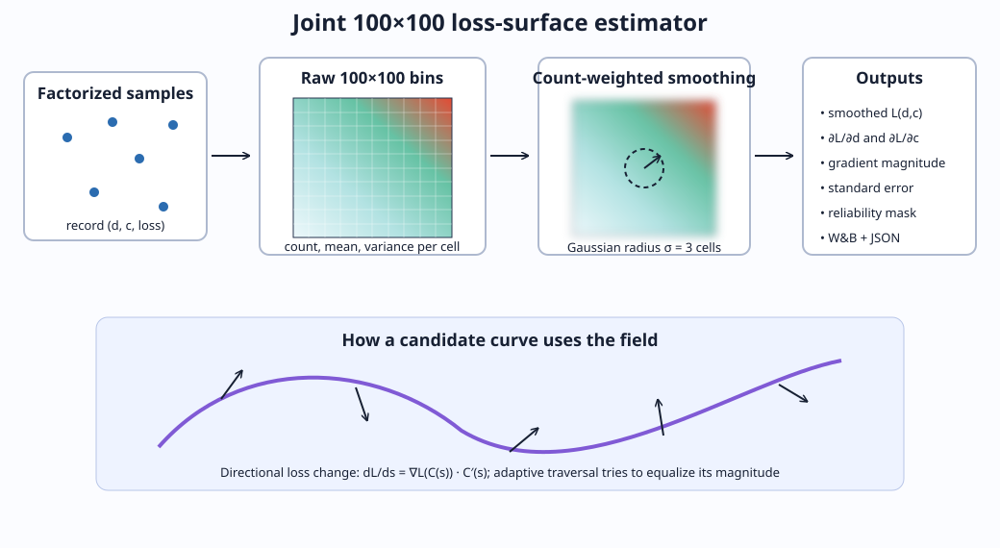

# CANDI two-axis adaptive-schedule ablation

## Goal

CANDI corrupts a sequence in two ways at once:

1. **Discrete corruption** removes or replaces token identity.
2. **Continuous rank degradation** adds Gaussian noise that weakens the ordering of token candidates.

The original implementation ties both mechanisms to one scalar time. This study asks whether CANDI trains slowly because that fixed relationship is suboptimal, and separates three questions:

- Which path through the two-dimensional corruption plane should the model follow?
- How should training and sampling time be allocated along a chosen path?
- Is restricting training to any one-dimensional path worse than sampling the plane directly?

All compared models use the same tiny CANDI architecture, Sudoku dataset, initialization seed, optimizer, effective batch size, and **5,000 optimizer steps**.

## Coordinates and curve geometry

We describe a corruption state as `(d, c)`:

- `d=0, c=0`: clean data.
- `d=1, c=1`: maximally corrupted data.
- `d`: normalized discrete-corruption probability.
- `c`: normalized continuous rank degradation, mapped to CANDI's rank-percentile range `0.05 → 0.40` and then to Gaussian sigma.

A curve is a monotone map

\[
C(s)=(d(s),c(s)),\qquad s\in[0,1].
\]

Training moves from clean to noisy as `s` increases; generation follows the same path in reverse.

### Fixed versus adaptive traversal

Curve geometry and traversal are intentionally separate:

\[
t \xrightarrow{g} s \xrightarrow{C} (d,c).
\]

- A **fixed** run uses the ordinary nearly linear path time.
- An **adaptive** run learns the monotone remapping `g(t)` from loss observations while keeping `C(s)` fixed.

For a nonlinear discrete curve, the likelihood weight includes the chain rule through `d(s)`. Nonlinear power curves include a 1% linear component to keep both axes numerically active near the endpoints.

## Joint loss surface

The factorized probe samples independent discrete and continuous times and records `(d, c, loss)` for each example. It accumulates a full **100×100** grid rather than only two marginal profiles.

Each raw cell tracks:

- Observation count.
- Mean loss.
- Loss variance.
- Standard error.

The smoothed surface is a count-weighted Gaussian estimate:

\[
\widetilde L=
\frac{G_\sigma*(N\widehat L)}{G_\sigma*N+\epsilon},
\qquad \sigma=3\text{ grid cells}.
\]

This prevents empty cells from acting like real global-mean observations. Cells also receive an effective-count reliability flag; the current threshold is `5.0` smoothed observations.

From the surface we compute

\[
\nabla \widetilde L(d,c)=
\left(\frac{\partial \widetilde L}{\partial d},
\frac{\partial \widetilde L}{\partial c}\right).
\]

For any candidate curve, the directional loss change is

\[
\frac{dL_C}{ds}=\nabla\widetilde L(C(s))^\top C'(s).
\]

This lets us visualize where a curve crosses rapidly changing regions and motivates a traversal that approximately equalizes `|dL_C/ds|`.

The full surface, vector components, uncertainty statistics, and reliability mask are saved as JSON and logged to W&B tables.

## Training variants

### Baselines and plane probe

| Run | Geometry | Traversal | Purpose |
|---|---|---|---|
| `legacy_fixed` | `d=s, c=s` | Fixed | Original CANDI control. |
| `linear_adaptive` | `d=s, c=s` | Adaptive | Isolates the value of scalar adaptive traversal. |
| `factorized_joint` | Independent `d` and `c` | Two adaptive marginals | Trains off-curve and estimates the 100×100 loss surface. |

At inference, the factorized marginals are coupled by equal quantiles. This is a canonical sampling curve, not a uniquely learned joint path.

### Continuous-first power curves

Before 1% linear regularization:

\[
d=s^p,\qquad c=1-(1-s)^p.
\]

| Run | Power | Interpretation |
|---|---:|---|
| `continuous_first_p2` | 2 | Mild continuous-first path. |
| `continuous_first_p4` | 4 | Stronger separation. |
| `continuous_first_p8` | 8 | Almost continuous-then-discrete. |

### Discrete-first power curves

\[
d=1-(1-s)^p,\qquad c=s^p.
\]

| Run | Power | Interpretation |
|---|---:|---|
| `discrete_first_p2` | 2 | Mild discrete-first control. |
| `discrete_first_p4` | 4 | Strong discrete-first control. |

### Bézier intermediates

Cubic monotone Bézier curves test smoother shapes that are not tied to a power law.

| Run | Control points | Interpretation |
|---|---|---|
| `bezier_continuous` | `(0.05,0.55)`, `(0.45,0.95)` | Smooth continuous-first path. |
| `bezier_discrete` | `(0.55,0.05)`, `(0.95,0.45)` | Mirrored discrete-first path. |

### Soft sequential paths

These use normalized sigmoid phases with sharpness `10`.

| Run | Discrete center | Continuous center | Interpretation |
|---|---:|---:|---|
| `sequential_continuous` | 0.7 | 0.3 | Continuous degradation largely precedes discrete corruption. |
| `sequential_discrete` | 0.3 | 0.7 | Discrete corruption largely precedes continuous degradation. |

### Adaptive traversal on selected nonlinear curves

| Run | Fixed-geometry counterpart | Question |
|---|---|---|
| `continuous_first_p4_adaptive` | `continuous_first_p4` | Does loss-linearized traversal improve a strong continuous-first path? |
| `discrete_first_p4_adaptive` | `discrete_first_p4` | Can traversal rescue a discrete-first path? |
| `bezier_continuous_adaptive` | `bezier_continuous` | Does adaptation help a smoother intermediate geometry? |

## Main comparisons

| Scientific question | Comparison |
|---|---|
| Does adaptation help the original schedule? | `legacy_fixed` vs. `linear_adaptive` |
| Which corruption mechanism should advance first? | Continuous-first vs. discrete-first families |
| How extreme should axis separation be? | Continuous-first `p2`, `p4`, and `p8` |
| Does detailed shape matter beyond ordering? | Power vs. Bézier vs. sequential curves |
| Is geometry or traversal responsible? | Fixed curve vs. its adaptive counterpart |
| Is a one-dimensional curve itself restrictive? | Curve runs vs. `factorized_joint` |
| Where does model difficulty change in the plane? | 100×100 surface and vector field |

## Execution and evaluation

- Training: 5,000 optimizer steps per run.
- Concurrency: at most three jobs per GPU on CUDA 5, 6, and 7.
- W&B project: `sudoku-candi-curves-5k`.
- Initial screening: the same 500 Sudoku puzzles at 90 NFE.
- Metrics: exact-board accuracy, cell accuracy, and valid-grid rate.
- Finalists: full 2,000-puzzle evaluation at 45, 90, and 180 NFE.

The screening pipeline writes `new_candi_curve_results/summary.csv`. Joint surfaces are stored under the `factorized_joint` run directory and in W&B.

## Interpretation guide

- If all continuous-first curves beat their discrete-first mirrors, rank information should be degraded before token identity is removed.
- If only adaptive versions improve, the original geometry may be adequate but poorly parameterized in time.
- If geometry changes dominate adaptive traversal, the fixed CANDI coupling is the main limitation.
- If `factorized_joint` wins, restricting training to a curve may discard useful off-curve corruption states.
- If a curve performs well at 180 NFE but poorly at 45 NFE, its geometry or traversal is difficult to discretize efficiently.
- The 100×100 field is diagnostic: high gradients identify sensitive regions, but an optimal path still requires an explicit path objective rather than blindly following the direction of greatest loss increase.
