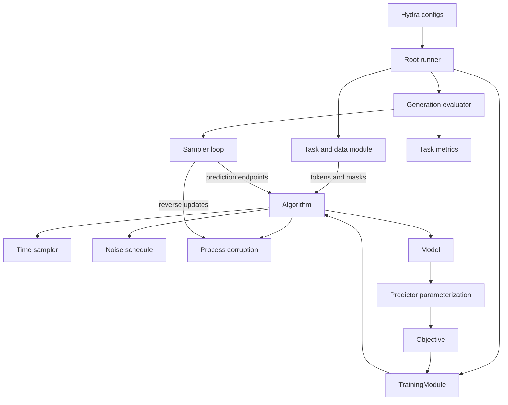

# Architecture and ownership

The algorithm coordinates training and model-to-prediction conversion. The sampler
coordinates generation. Components own the mathematics needed by both, so an
algorithm does not need to contain a reverse-time loop or every sampling variant.

This is a responsibility diagram, not a requirement that every method call the
same function sequence. RePlaid has multiple loss terms; hybrids maintain several
branch states; autoregressive generation has no diffusion schedule.

## Repository layout

| Location | Contents |
| --- | --- |
| `main.py` | Hydra entrypoint for training, evaluation, and sampling. |
| `frontier.py` | Hydra entrypoint for pretrained evaluation grids. |
| `configs/` | Component groups and experiment recipes. |
| `core/algorithms/` | Training and prediction coordination. |
| `core/training/` | Lightning lifecycle, runners, checkpoint/EMA handling. |
| `core/evaluation/`, `core/tasks/`, `core/data/` | Generation evaluation, task semantics, datasets. |
| `core/models/`, `core/parameterizations/` | Architectures and predictor meanings. |
| `core/processes/`, `core/noise_schedules/`, `core/time_sampling/` | Corruption dynamics and time/noise choices. |
| `core/representations/`, `core/objectives/`, `core/samplers/` | Continuous encodings, losses, generation updates. |
| `core/modifiers/` | Shared modifiers, including hybrid view composition. |
| `core/tests/` | Mathematical, configuration, and execution checks. |

The library does not import the removed legacy repository modules. Third-party
libraries and explicit dataset/checkpoint paths are external dependencies. The
complete runnable distribution includes the library, root runners, configs, and
uv files; copying only `core/` omits the CLI and configuration catalog.

## A training step

1. Task collation supplies tokens and loss/corruption masks. The data module
   computes the per-device microbatch from global batch size and accumulation.
2. `TrainingModule` calls `algorithm.loss(...)`, providing global step and time
   sampling context, including distributed rank and accumulation index.
3. The algorithm samples time, evaluates the schedule, corrupts the clean data,
   obtains a parameterized prediction, and evaluates the objective. The particular
   method determines its representation, weighting, and adaptive feedback.
4. Lightning performs backward/optimizer steps. EMA updates and component
   `post_optimizer_step` hooks run in the training wrapper.

The mathematical loss belongs to the objective; reductions and assembly can belong
to the algorithm. The Lightning wrapper owns optimizer/checkpoint/logging policy,
not the diffusion equations.

## A generation call

The evaluator asks the Task for prompts and fixed-position masks, constructs the
sampler, and selects raw or EMA weights. The algorithm's `generate` endpoint delegates
to that sampler. The sampler owns state initialization, time progression, transition
calls, stopping, and NFE accounting. It uses algorithm prediction endpoints and
available processes/schedules rather than duplicating model preparation.

The predictor owns inference shaping. The model owns architecture and conditioning.
The Task scores final token sequences; it does not need to know whether generation
was discrete diffusion, a continuous solver, or autoregressive decoding.

## Shared execution components

Mathematical ownership is separate from execution reuse. Fixed-grid samplers share
a loop that accepts an update callable; discrete reverse rules and continuous
integration rules obtain predictions through the algorithm and use process
mathematics. A multi-stage integration rule can make multiple model calls within
one accepted-step feedback context. EB completion, adaptive ODE integration and
autoregressive cache progression retain their specialized control flow.

Models share `TextDiT` execution with replaceable input, output and conditioning
components. A representation still defines the space where corruption happens;
the model input adapter maps that noisy state to transformer hidden vectors.
Continuous input projections remain in place. Causal models retain a distinct
block execution policy for their KV caches and query/key positions, while hybrid
and block-diffusion wrappers use the shared hidden-state entrypoints.

The public model constructors retain their parameter paths and initialization so
existing checkpoints and config targets remain usable. These two execution layers
are independent: changing a sampling rule does not require changing the model,
and changing a model input adapter does not require changing the sampler.

## Shared features

[Self-conditioning](../modifiers/self-conditioning.md) coordinates a bootstrap or
previous prediction with an architectural input path. [Block diffusion](../modifiers/block-diffusion.md)
adds sequence layout, attention, and block generation behavior without embedding
block mathematics in every algorithm.

[Hybrids](../methods/hybrids.md) maintain multiple noisy views of the same clean
sequence. Branches encapsulate local processes/schedules/adapters; a model fuses
branch embeddings before its shared backbone. This is an intentional composite
component, not a blanket rule that components can never call other components.

See [component contracts](component-contracts.md) for the mathematical boundaries
and [adding a method](../extending/adding-a-method.md) for practical extension rules.
