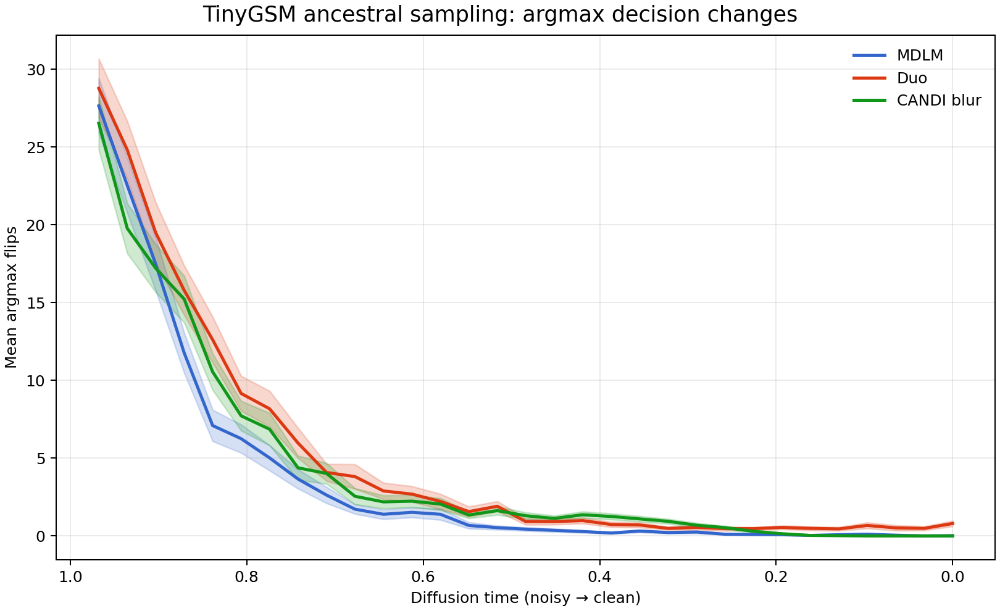

# TinyGSM inference results

Last updated: 2026-08-23

This document summarizes the current 64-example TinyGSM inference experiments
for the released S-FLM MDLM and Duo checkpoints and the local CANDI-blur
checkpoint. Unless noted otherwise, evaluations use the same seed-42 subset,
a 512-token context, temperature 0.1, and code-execution accuracy.

These are small-subset measurements, not full-test-set estimates. A difference
of one correct example changes accuracy by 1.56 percentage points.

## Primary results

| Model | Sampler | Temperature | NFE | Accuracy | Mean argmax flips | Positions ever flipped |
|---|---|---:|---:|---:|---:|---:|
| MDLM | ancestral | 0.1 | 32 | 23.44% (15/64) | 113.88 | 52.73 |
| Duo | ancestral | 0.1 | 32 | 25.00% (16/64) | 154.09 | 54.73 |
| CANDI blur | stochastic posterior | 0.1 | 32 | 12.50% (8/64) | 132.97 | 51.77 |
| CANDI blur | DDIM continuous | 0.1 | 32 | 17.19% (11/64) | 129.08 | 53.02 |
| CANDI blur | DDIM continuous | 0.1 | 128 | 17.19% (11/64) | 185.50 | 56.45 |

The released MDLM and Duo numbers above were obtained with the original S-FLM
implementation and its literal `\\n` prompt separator. Using an actual newline
changes tokenization, overwrites the start of the generated function, and
invalidates the comparison.

The argmax statistic compares `argmax p(x0 | xt)` at every pair of consecutive
model evaluations, excludes prompt positions, and sums changed positions. A
32-NFE run therefore has 31 comparisons.

## Argmax-decision plots



The solid curves are the mean number of changed positions at each transition;
shading is plus or minus one standard error over 64 examples. The underlying
values are in
[tinygsm_argmax_flips_overlay_mdlm_candi_duo_n64.csv](../analysis_results/tinygsm_argmax_flips_overlay_mdlm_candi_duo_n64.csv).

A three-panel version is also available at
[tinygsm_argmax_flips_mdlm_duo_candi_blur_n64.png](../analysis_results/tinygsm_argmax_flips_mdlm_duo_candi_blur_n64.png).

## CANDI-blur continuous transitions

The standard CANDI-blur posterior transition samples fresh Gaussian noise in
the separable position/feature mode basis. Its reverse step is stochastic, as
is its discrete reveal schedule.

The implemented DDIM transition instead preserves the inferred noise across
steps:

```text
epsilon_hat = (z_t - A_t z0_hat) / sigma_t
z_s         = A_s z0_hat + sigma_s epsilon_hat
```

This makes the continuous trajectory deterministic conditional on its initial
state. The Gaussian prior and discrete reveal schedule remain stochastic. Use:

```bash
algo.continuous_transition=ddim
```

Simply setting the posterior noise scale to zero is not DDIM and fails:

| Continuous transition | NFE | Accuracy | Parsed | Mean argmax flips |
|---|---:|---:|---:|---:|
| Stochastic posterior | 32 | 12.50% | 98.44% | 132.97 |
| Posterior mean (`continuous_noise_scale=0`) | 32 | 0.00% | 0.00% | 1,139.94 |
| DDIM shared-noise transition | 32 | 17.19% | 100.00% | 129.08 |

The posterior-mean path moves off the learned noisy-state distribution and
produces repetitive, non-parsable output. DDIM preserves the forward marginal
structure and avoids this collapse.

Increasing DDIM from 32 to 128 NFEs did not improve aggregate accuracy. Both
runs solved 11 examples, but only five were shared: six were unique to the
32-NFE run and six were unique to the 128-NFE run.

## Entropy-bounded sampling

| Model | Continuous path | Entropy settings | Decision temperature | Mean NFE (range) | Accuracy |
|---|---|---|---:|---:|---:|
| MDLM | n/a | gamma=0.1, categorical | 1.0 | 82.95 (23-175) | 29.69% (19/64) |
| CANDI blur | DDIM | gamma=0.1, greedy, untempered entropy | 0.1 | 114.36 (22-203) | 14.06% (9/64) |

For CANDI blur, temperature 0.1 controls clean-token decisions, while EB ranks
and accepts positions using temperature-1 probabilities from the same forward
pass. No additional NFE is required to calculate the untempered entropy.

MDLM EB must likewise use temperature 1.0 for a calibrated entropy criterion.
Using temperature 0.1 collapses the entropy and commits too many tokens at
once:

| MDLM EB diagnostic | Mean NFE | Accuracy |
|---|---:|---:|
| gamma=0.1, categorical, temperature 0.1 | 3.50 | 0.00% (0/64) |
| gamma=0.1, greedy, temperature 0.1 | 3.50 | 1.56% (1/64) |
| gamma=0.1, categorical, temperature 1.0 | 82.95 | 29.69% (19/64) |

At the settings tested, MDLM benefits from EB at the cost of more NFEs.
CANDI-blur DDIM does not: fixed 32-NFE DDIM is both more accurate and cheaper
than DDIM plus EB.

## Result artifacts

### MDLM and Duo

- [MDLM ancestral, temperature 0.1, 32 NFE](../analysis_results/sflm_upstream_mdlm_trace64/results.json)
- [Duo ancestral, temperature 0.1, 32 NFE](../analysis_results/sflm_upstream_duo_trace64/results.json)
- [MDLM EB, temperature 1.0](../new_eval_results/tinygsm_sflm/mdlm_eb_gamma0p1_temp1p0_n64/results.json)
- [MDLM EB, temperature 0.1 diagnostic](../new_eval_results/tinygsm_sflm/mdlm_eb_gamma0p1_temp0p1_n64/results.json)
- [MDLM greedy EB, temperature 0.1 diagnostic](../new_eval_results/tinygsm_sflm/mdlm_eb_greedy_gamma0p1_temp0p1_n64/results.json)

### CANDI blur

- [Stochastic posterior, 32 NFE](../new_eval_results/tinygsm_candi_blurred/candi_blurred_ancestral_temp_0p1_n64_steps32/results.json)
- [DDIM, 32 NFE](../new_eval_results/tinygsm_candi_blurred/candi_blurred_ddim_temp_0p1_n64_steps32/results.json)
- [DDIM, 128 NFE](../new_eval_results/tinygsm_candi_blurred/candi_blurred_ddim_temp_0p1_n64_steps128/results.json)
- [Posterior-mean failure diagnostic](../new_eval_results/tinygsm_candi_blurred/candi_blurred_deterministic_cont_temp_0p1_n64_steps32/results.json)
- [DDIM plus EB with untempered entropy](../new_eval_results/tinygsm_candi_blurred/candi_blurred_ddim_eb_greedy_gamma0p1_untempered_entropy_n64_steps512/results.json)

## Current takeaways

1. Duo has the strongest fixed-32-NFE ancestral result on this subset at 25.00%.
2. MDLM EB at temperature 1.0 is the strongest result overall at 29.69%, but
   averages about 83 NFEs.
3. DDIM is the best CANDI-blur transition tested: 17.19% at 32 NFEs.
4. Raising CANDI-blur DDIM to 128 NFEs does not improve aggregate accuracy.
5. Removing posterior noise without a DDIM-consistent update is invalid and
   causes complete generation collapse.
6. Entropy must be calculated from untempered probabilities when the token
   decision temperature is changed.
